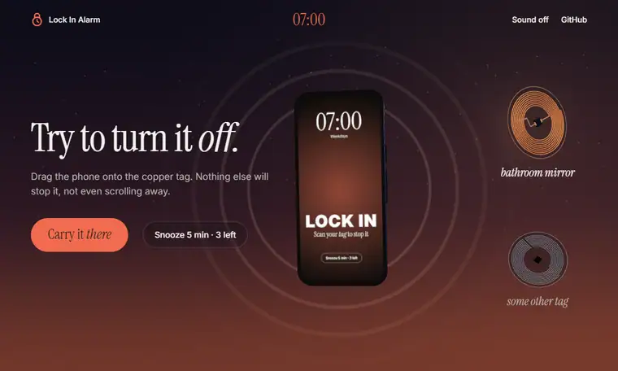
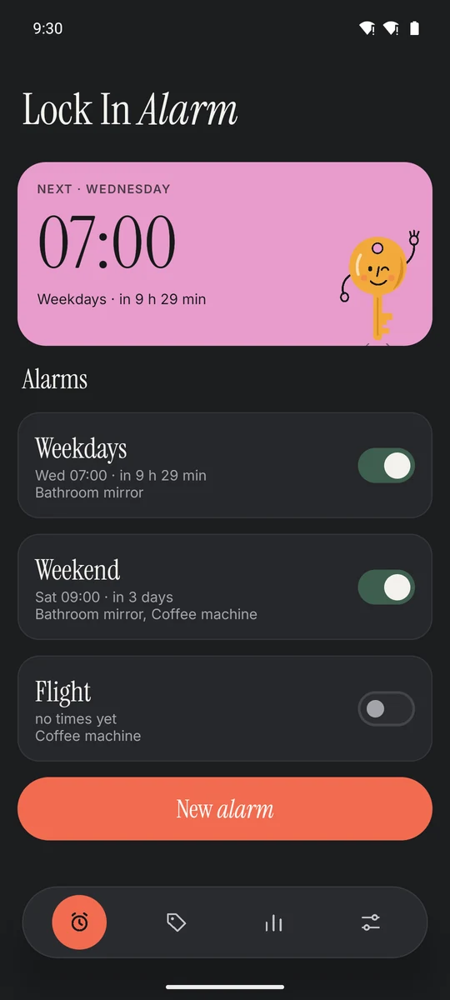
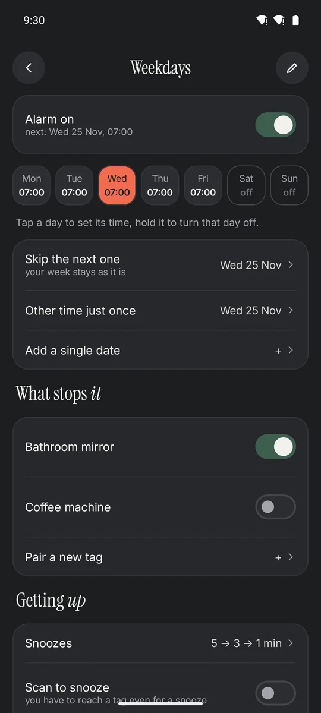
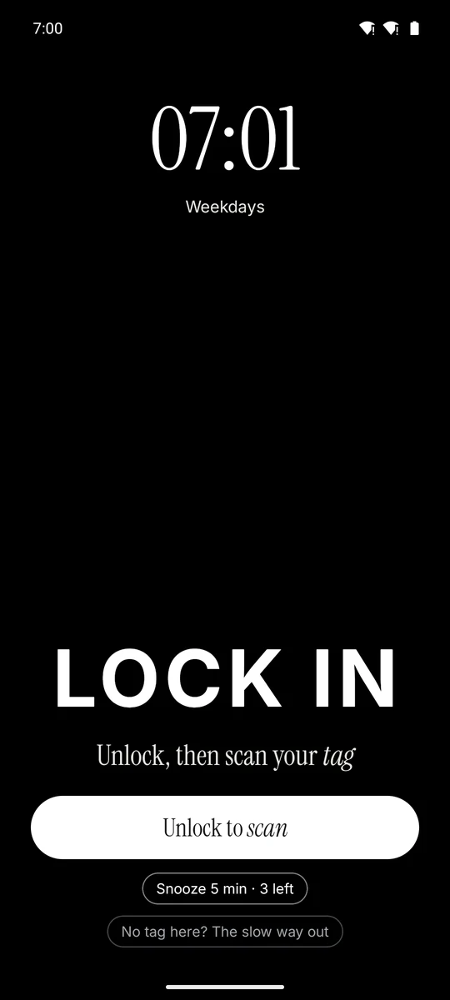
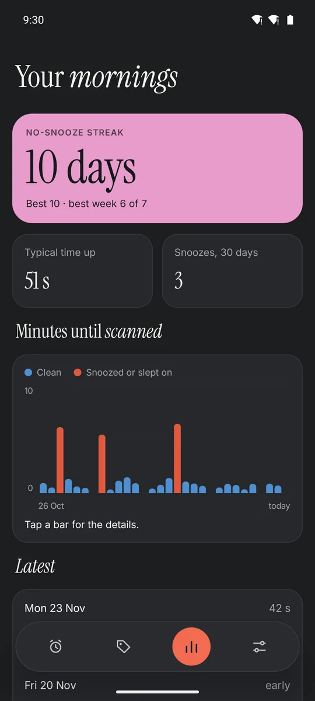

<div align="center">


# Lock In Alarm

**An Android alarm that rings until you scan an NFC sticker.**<br>
Put the sticker in the bathroom. Now you're up.

[**Try to turn it off →**](https://aminechr54.github.io/lockin-alarm-android-app/) &nbsp;·&nbsp; [**Download the APK**](https://github.com/AmineChr54/lockin-alarm-android-app/releases/latest)

<a href="https://aminechr54.github.io/lockin-alarm-android-app/"></a>

</div>

Offline by design: no account, no server, **no internet permission**. Android 13+ with NFC.

| | | | |
|:-:|:-:|:-:|:-:|
|  |  |  |  |
| Alarms | What stops it | Ringing | Your mornings |

## Features

**Getting you up**
- **Tags**: pair any NFC tag with a fixed ID. Nothing is written to it. Per alarm: any of its tags, a random one each morning, or all of them in order.
- **Shrinking snooze**: 5 → 3 → 1 min, optionally only by scanning a tag.
- **Awake check**: some minutes after the scan it asks "Still up?". No answer within 60 s and it rings again, without snoozes (up to 3 rounds).
- **Sunrise**: the screen brightens before the ring. Scan during it and it won't ring.
- **Sound build-up**: instant, 30 s, 60 s or 3 stages, with the volume forced to maximum if you like.

**Keeping you honest**
- **Commitment lock**: in the hours before it rings, an alarm can only get stricter (or up to 2 h earlier).
- **Slow way out**: lost the tag? After a minute of ringing you can type 11 sentences, about 5 min, while it keeps ringing.
- **Stats**: streaks and wake-up times, on the phone only.

**Reliability**
- **Bedtime check**: a notification tells you what would go wrong tonight (NFC, notifications, Do Not Disturb, battery, volume, tag).
- **Reboot-proof**: rings before the first unlock, and up to 30 min late if the phone was off.
- **Flexible**: several alarms, one time per weekday, skip once, another time just once, single dates. Own sound, photo and text.
- **Sharing**: send your setup as a `.lockin` file, without tags or stats.

**What it can't stop:** force-stopping the app, uninstalling it, or switching the phone off.

## Install

**[Download the latest APK](https://github.com/AmineChr54/lockin-alarm-android-app/releases/latest)** on your phone, open it, and allow installing from that app when Android asks. Updates install over it.

Then, on the phone:

1. Open it and go through **Before it works** (NFC, notifications, full-screen alarm, Do Not Disturb access).
2. **Tags → Pair a tag**, and hold the sticker to the back of the phone. NTAG213 or NTAG215 stickers work well. Pair a spare too.
3. Create an alarm, choose its tag, and run **Test ring in 10 s** (silent) before you rely on it.

> Phone makers differ in how hard they kill background apps. If yours has a battery setting for single apps, allow Lock In Alarm to run unrestricted.

### Build it yourself

You need JDK 17+, the Android SDK (platform 37) and a phone with USB debugging.

```sh
git clone https://github.com/AmineChr54/lockin-alarm-android-app
cd lockin-alarm-android-app
./gradlew assembleRelease
adb install -r app/build/outputs/apk/release/app-release.apk
```

Set `ANDROID_HOME`, or put `sdk.dir=/path/to/Android/sdk` into `local.properties`. Your build is signed with your own debug key, so uninstall the downloaded APK before switching to it.

## Code

Kotlin and Jetpack Compose, no third-party libraries beyond AndroidX and coroutines.

| | |
|---|---|
| `Model` `Schedule` `Session` `Lock` `Stats` `Pack` | Pure Kotlin, unit-tested. `Session` holds the `Wake` state machine: (session, event, time) → what happens |
| `Engine` | Connects the rules to Android. Every edit goes through it, so the lock can't be bypassed |
| `AlarmService` `AlarmActivity` `Notify` | Sound, the full-screen alarm and the NFC reader |
| `Store` | Device-protected storage, readable before the first unlock |
| `ui/` | Screens |

```sh
./gradlew testDebugUnitTest
```

Debug builds have adb hooks for trying things without waiting for morning, see `MainActivity.debugHooks`. Faked tags and rings work on an emulator only:

```sh
adb shell am start -n app.lockinalarm/.MainActivity --es add_tag t1 --ei ring_in 1   # rings at the next full minute
adb shell am start -n app.lockinalarm/.MainActivity --es tag t1                      # "scan" it
```

## Website

`docs/` is the [site](https://aminechr54.github.io/lockin-alarm-android-app/): plain HTML, CSS and JavaScript without a build step. The phone, the tags and the sky are modelled in code with [three.js](https://threejs.org), which is bundled in `docs/vendor`. Nothing is loaded from other servers.

```sh
cd docs && python -m http.server
```

## License

[MIT](LICENSE). The bundled fonts and three.js keep their own licenses:

[Instrument Serif](https://github.com/Instrument/instrument-serif) and [Inter](https://github.com/rsms/inter) (SIL Open Font License), [three.js](https://github.com/mrdoob/three.js) (MIT). The alarm tone is synthesized by `design/gen_tone.py`.
